<h1 align="center">🧬 DNA-AND 🌌</h1>

<p align="center"><b><i>One spark. One planet. One galaxy. Every gene fighting to live.</i></b></p>

<p align="center">
  <a href="https://github.com/Unity-Lab-AI/DNA-AND/releases/latest" title="The latest release on GitHub: the installer and the zip"><b>⬇️ DOWNLOAD THE LATEST RELEASE</b></a>
  &nbsp;·&nbsp;
  <a href="https://git.unityailab.com/GFourteen/DNA-AND/releases" title="The same release on Unity AI Lab Git"><b>Unity AI Lab Git</b></a>
</p>

> **Get it in one minute.** The current release is **0.1.5, the universe preview**: the universe of DNA-AND before any life is in it. Download **[DNA-AND-Setup-0.1.5.exe](https://github.com/Unity-Lab-AI/DNA-AND/releases/download/v0.1.5/DNA-AND-Setup-0.1.5.exe "The installer, 0.8 MB, from GitHub")** (0.8 MB) and run it, or the **[zip](https://github.com/Unity-Lab-AI/DNA-AND/releases/download/v0.1.5/DNA-AND-0.1.5-windows.zip "DNA-AND-0.1.5-windows.zip: unpack anywhere and run DNA-AND.exe")** to unpack anywhere and run `DNA-AND.exe`. The same two files are on **[Unity AI Lab Git](https://git.unityailab.com/GFourteen/DNA-AND/releases "The release on the lab's own Git")**. Needs Windows 10 or 11 (64-bit) and a Direct3D 12 graphics card; installed it is under 2 MB. **On Linux**, take the zip and run the script inside it, through Wine: [On Linux](docs/release/UNIVERSE-LINUX.md "On Linux, through Wine: one script"). What you get now: one continuous zoom from the cosmic web of 100 billion galaxies down to the quarks inside a grain of sand, a guided tour (press **T**), and a card on everything you click. The life, the genes and the god powers below are what the game grows into.

<p align="center">🔞 18+ &nbsp;·&nbsp; 🪟 Windows 10 | 11 &nbsp;·&nbsp; 🎮 Single · Co-op · Multiplayer (up to 8) &nbsp;·&nbsp; 🛠️ 100% built from scratch</p>

<!-- IMG: docs/img/banner.png | Wide banner: a living blue planet, a strand of DNA curling into a spiral galaxy, a Dyson sphere glowing behind it -->
> 🖼️ *Wide banner: a living blue planet, a strand of DNA curling into a spiral galaxy, a Dyson sphere glowing behind it* — rendered by the game's own 3D generator

---

## 🌑 In the beginning, there's nothing

A dead rock. A young star. Lightning in a poisoned sky.

**You are its god.**

Strike the shallow seas with lightning and the first chemistry stirs. Warm them, feed them the right elements, and something **copies itself**. That's life. It's yours, and it won't do what you tell it.

Because every living thing in DNA-AND carries a **real genome**, and every gene in it is **selfish**. Microbes swarm, viruses steal genes, fish crawl onto land, wolves form packs, packs form hordes. One day the hordes start to **think**. They build fires, then cities, then rockets, then a shell of machines around their star.

And somewhere along the way, they start to wonder **who you are**.

---

## 🧭 The journey

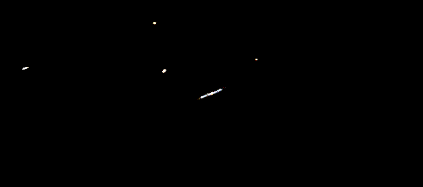

## Watch it

Five stretches of one filmed tour, each played as it was flown (press the player's full-screen button to watch it large).

**Across the universe.** Out through the cosmic web, past galaxy after galaxy, closing on the first.

https://github.com/user-attachments/assets/f5d5b96c-b4d3-4b18-ac16-2ffa0cfe0fbc

**Into the black hole.** Down the galaxy's middle and into its black hole, the sky squeezed into its mouth.

https://github.com/user-attachments/assets/aaee4d09-5d91-4ba8-a19b-361733e569f4

**Planetfall.** Down onto a world, the ground under you, then into the face of a grain.

https://github.com/user-attachments/assets/b324cbfa-dfbd-4d61-96e4-c5bcff5f0a97

**Into the atom.** Through an atom's electron clouds to its nucleus, a proton, and a quark.

https://github.com/user-attachments/assets/c7143e5b-391d-4f35-9920-6c34a88941c3

**Out across the universe.** Up off the world, out of its star system and away past the galaxies.

https://github.com/user-attachments/assets/7c437893-42eb-4039-ae33-116f7edaf0ea


## 📸 A look inside

Straight from the game, drawn live by its own generators. It all joins up into one zoom, from the cosmic web of galaxies down to the microbes in the soil, and on into the matter to the quarks:

<table>
<tr>
<td width="50%">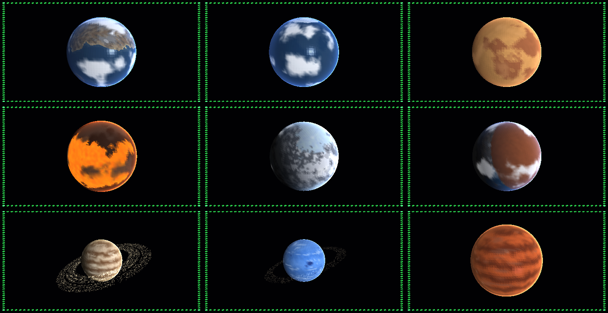<br><b>🪐 Every world is different.</b> Earth-like, ocean, desert, lava, snowball, tidally locked, and giants with rings and storms.</td>
<td width="50%">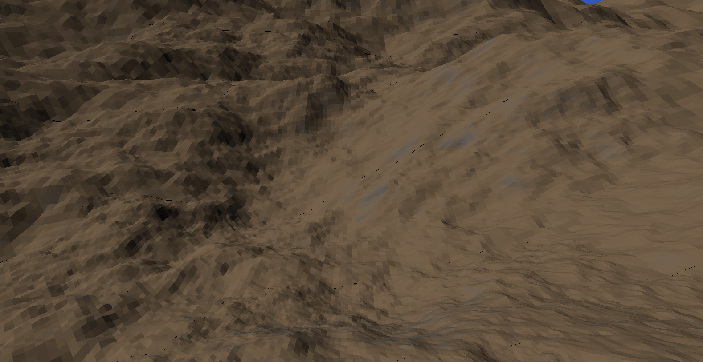<br><b>🔎 Zoom all the way down.</b> From orbit to standing on the ground, and on down to the size of a microbe.</td>
</tr>
<tr>
<td>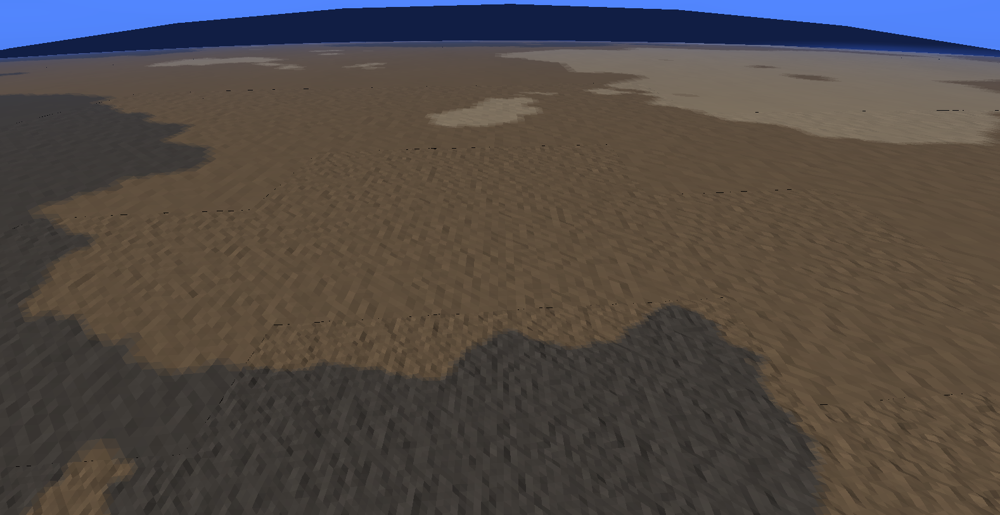<br><b>🏔️ Real land.</b> Seas, coasts, soil, rock and snow, rough at every size.</td>
<td>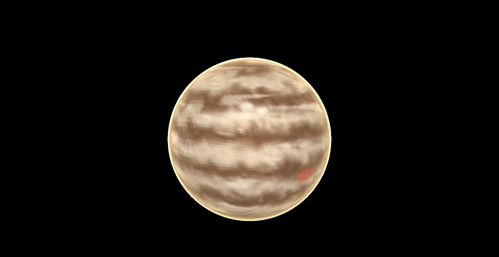<br><b>🌀 Giants with weather.</b> Wind-curled bands, storms and high clouds you can fly down into.</td>
</tr>
<tr>
<td>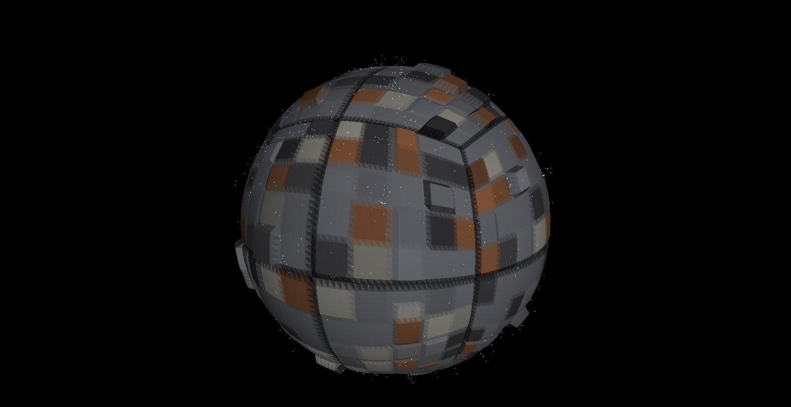<br><b>🏭 Dyson spheres.</b> A metal megastructure wrapped around a whole star.</td>
<td>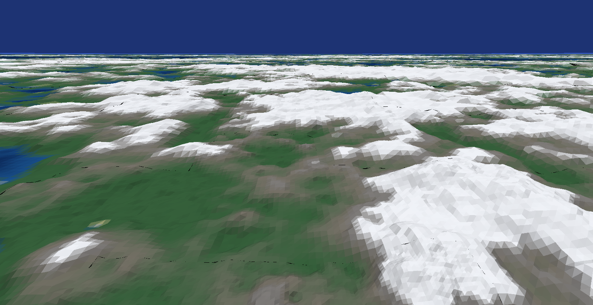<br><b>🌄 A world inside out.</b> Go inside: land, seas and mountains on the inner surface, the star overhead.</td>
</tr>
<tr>
<td>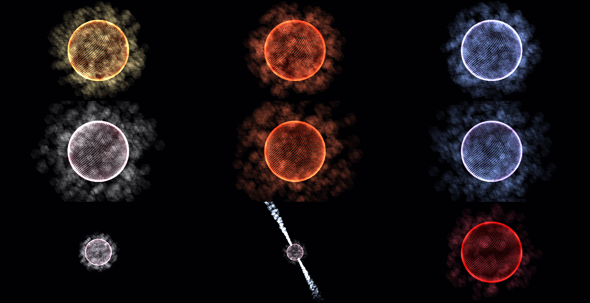<br><b>⭐ Living stars.</b> Boiling plasma, spots and coronas, from red dwarfs to pulsars.</td>
<td>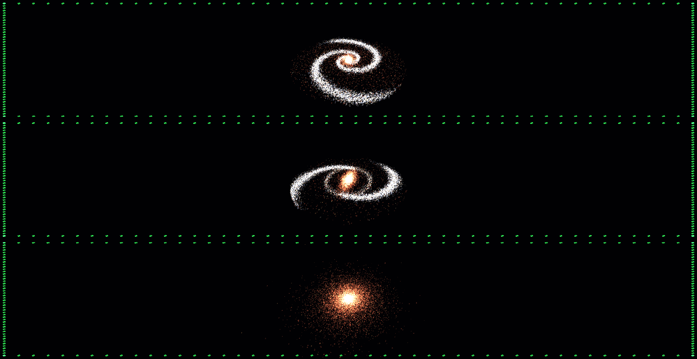<br><b>🌌 Whole galaxies.</b> Click one and fly into it, down to a single star's planets.</td>
</tr>
</table>

🔭 **The universe preview, as it is now.** Frames from the grand tour, as the game records it, from the cosmic web to the quarks:

<table>
<tr>
<td width="33%">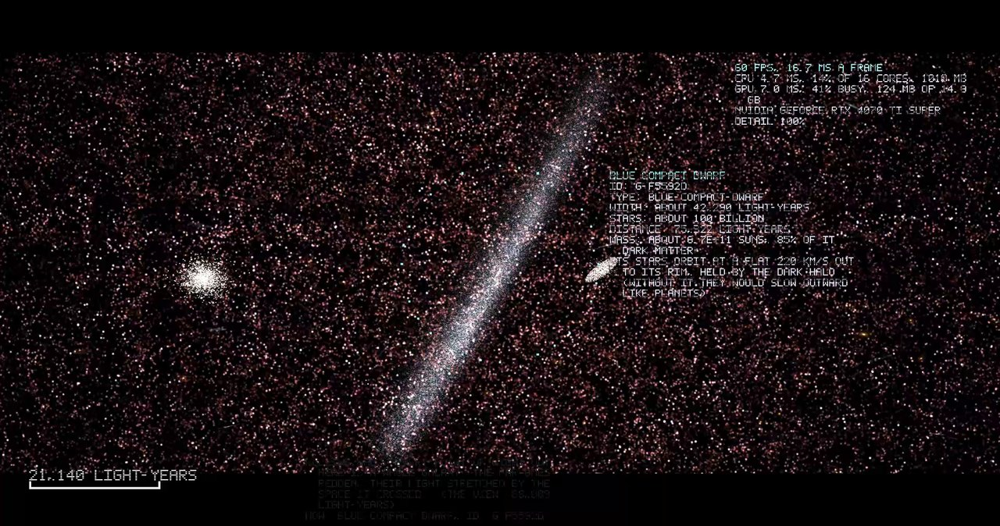<br><b>Among the stars of a galaxy</b></td>
<td width="33%">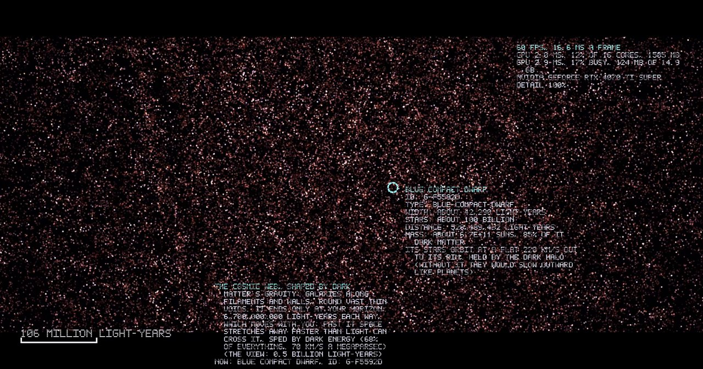<br><b>The cosmic web</b></td>
<td width="33%">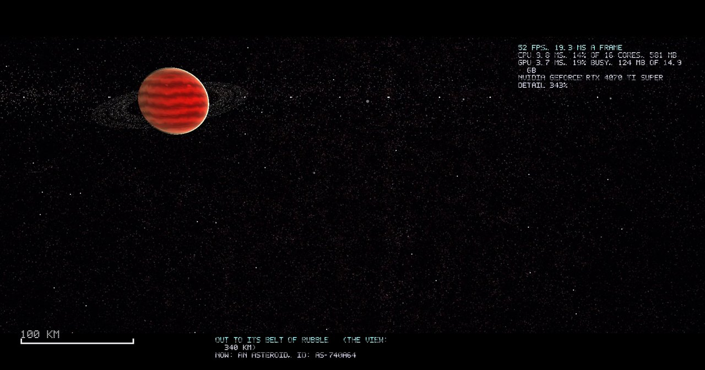<br><b>A gas giant from its belt</b></td>
</tr>
<tr>
<td width="33%">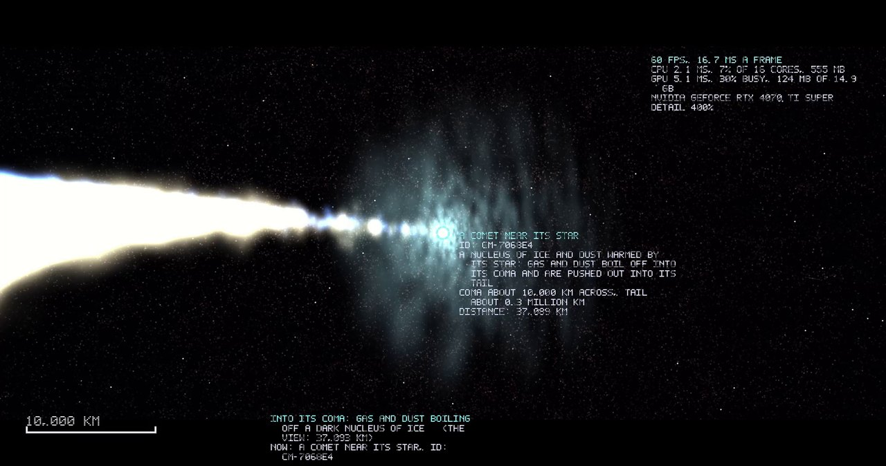<br><b>A comet near its star</b></td>
<td width="33%">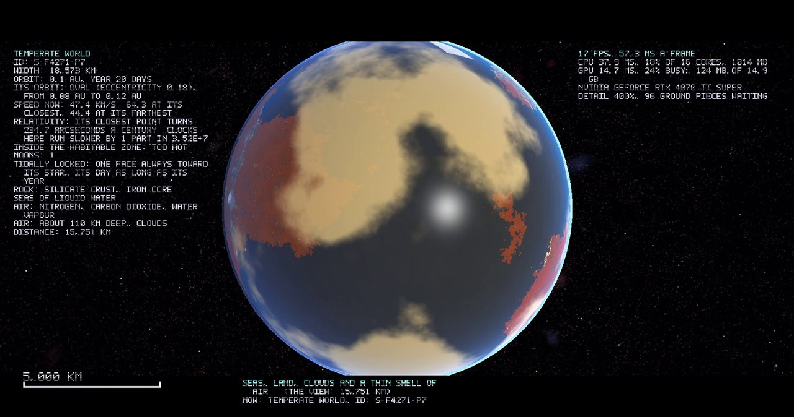<br><b>A temperate world</b></td>
<td width="33%">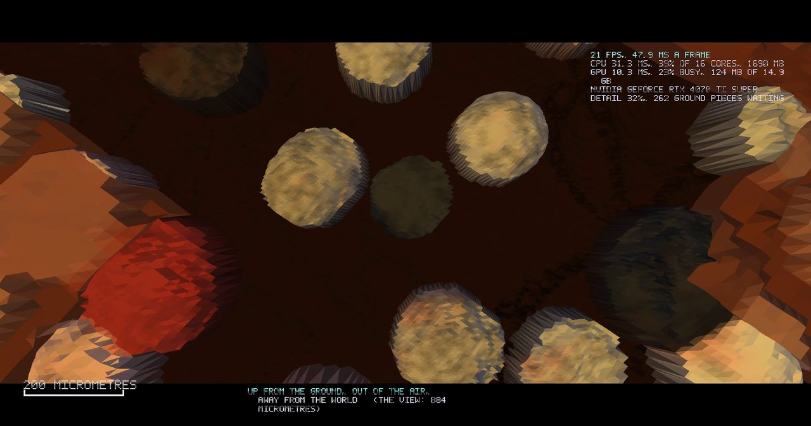<br><b>On the ground</b></td>
</tr>
<tr>
<td width="33%">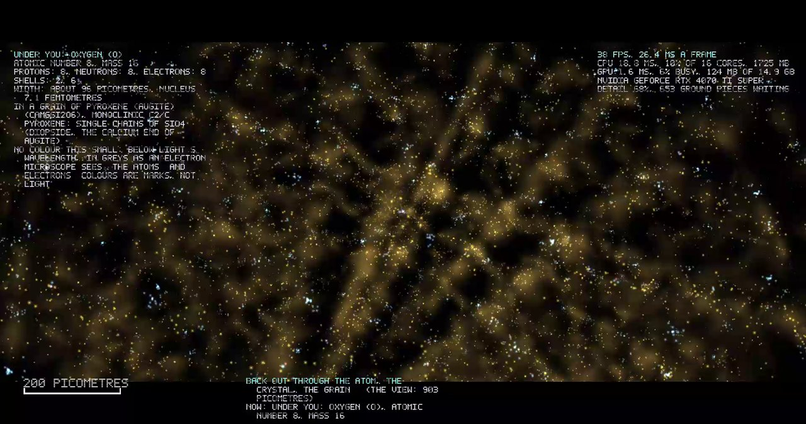<br><b>Inside a crystal</b></td>
<td width="33%">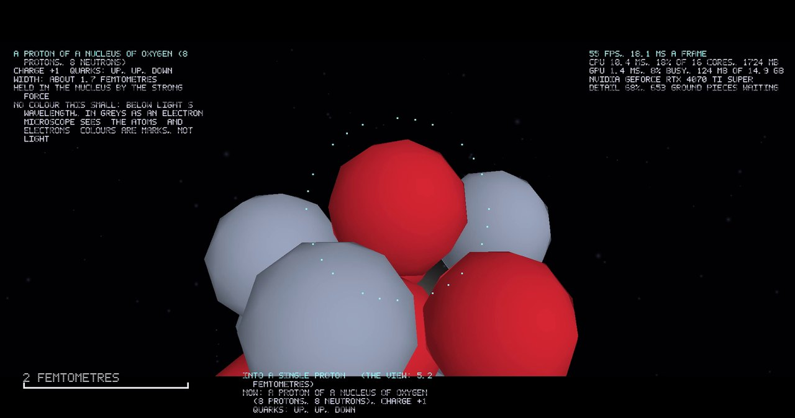<br><b>A nucleus</b></td>
<td width="33%">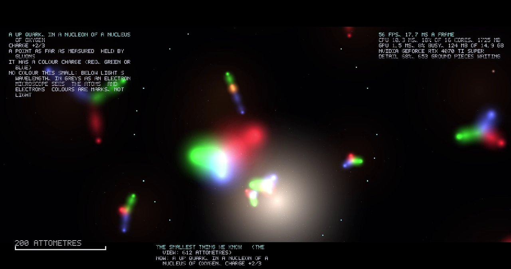<br><b>The quarks</b></td>
</tr>
</table>

Still to come:

<table>
<tr>
<td width="50%">
<!-- IMG: docs/img/shot-first-cells.png | Close-up of the first cells drifting in a warm volcanic pool -->
🖼️ <i>The first cells in a volcanic pool</i><br><b>🦠 The spark.</b> The first living thing in a dead universe. You made it.
</td>
<td width="50%">
<!-- IMG: docs/img/shot-god-view.png | Top-down god view of a continent with storm clouds and a power cursor -->
🖼️ <i>Top-down god view of a continent</i><br><b>⚡ God mode.</b> Fire, flood, plague, miracle. Choose what to give, and what to take.
</td>
</tr>
<tr>
<td>
<!-- IMG: docs/img/shot-wolf-horde.png | A horde of wolves pouring over a snowy ridge at dusk, a wolf-folk village of stone huts in the valley below -->
🖼️ <i>A wolf horde above a wolf-folk village</i><br><b>🐺 All things flock.</b> The wolves you watched hunting a million years ago are building villages now.
</td>
<td>
<!-- IMG: docs/img/shot-tree-of-life.png | The circular tree of life glowing over a dark screen, thousands of branches, extinct ones greyed -->
🖼️ <i>The circular Tree of Life</i><br><b>🌳 Every species, ever.</b> Every ancestor and every gene line, on one living circle.
</td>
</tr>
<tr>
<td>
<!-- IMG: docs/img/shot-civilization.png | A medieval city by a river, fields around it, a volcano smoking behind -->
🖼️ <i>A city in the shadow of a volcano</i><br><b>🏛️ Civilization.</b> They'll build, pray, fight, and notice you. A volcano on a city pays a lot of souls.
</td>
<td>
<!-- IMG: docs/img/shot-dyson-sphere.png | A Dyson sphere under construction around a yellow star -->
🖼️ <i>A Dyson sphere under construction</i><br><b>☀️ The endgame.</b> They've learned to wrap a star. Next comes the rest of the galaxy.
</td>
</tr>
</table>

---

## 🌌 A universe in full

| | |
|--|--|
| 🌀 **Galaxies** | Spirals, barred spirals, ellipticals, rings, starbursts, green peas, jellyfish galaxies, grouped into clusters, filaments and voids |
| ⭐ **Stars** | Every real type, from red dwarfs to blue hypergiants, brown dwarfs, carbon stars, white dwarfs, pulsars and magnetars, each with what it is made of; supernovae of every real kind, a neutron star, black hole or magnetar born at each |
| ⚫ **Black holes and quasars** | Stellar to ultramassive, spinning black holes, accretion disks and jets, quasars, blazars and Seyfert galaxies; the fall through the horizon to the singularity, down the gravity well itself, Flamm's surface as a grid round you |
| 🌫️ **Nebulas** | Star nurseries, pillars, dark clouds, planetary nebulas and supernova remnants |
| 🪐 **Worlds** | Lava worlds, ocean worlds, super-Earths, mini-Neptunes, hot Jupiters, ice giants, rogue planets |
| 🌙 **Moons** | Volcanic moons, ice-shell ocean moons with geysers, moons with thick air and hydrocarbon lakes |
| ☄️ **Small bodies** | Asteroids by makeup, comets and their tails, dwarf planets, the Kuiper belt, the Oort cloud, meteorites, each its own size and shape, with its real minerals and elements down to the traces, landed on as a world and zoomed into to its quarks |

👉 [The Deep Sky](docs/wiki/deep-sky.md "Galaxies, stars, black holes, nebulas") · [Worlds & Moons](docs/wiki/worlds-and-moons.md "Planets, giants, moons, comets")

---

## 🧬 Every kingdom of life

**Viruses · bacteria · archaea · protists · fungi · plants · animals**, each traced down through phylum, class, order, family, genus and species.

| | |
|--|--|
| 🦠 **The tiny** | All seven virus groups, bacteria that swap genes and build stromatolites, archaea that live in boiling acid |
| 🍄 **The hidden** | Fungal networks linking forests, lichens on bare rock, body-snatching fungi |
| 🌿 **The green** | Mosses to conifers to flowering plants, desert and hot-climate photosynthesis, carnivorous plants |
| 🐾 **The animals** | Every major phylum, from sponges to chordates; insects, birds and mammals order by order |
| 🧠 **The minds** | Crows, octopuses, dolphins, elephants and hives show how a mind can rise in any kingdom |

### 🦖 Lost worlds

The **Big Five mass extinctions**, **dinosaurs** of every kind (and birds, the ones that survived), pterosaurs, sea reptiles, trilobites, giant insects, mammoths and saber-toothed cats. Your worlds can evolve their like again.

👉 [Life's Kingdoms](docs/wiki/lifes-kingdoms.md "Every kingdom of life") · [Lost Worlds](docs/wiki/lost-worlds.md "Dinosaurs and extinctions")

---

## ⛏️ Built and mined

| | |
|--|--|
| ⛏️ **Riches of the land** | Real ore deposits made by magma, hot water, seas and weather. Coal, oil and gas only exist where life lived first |
| 🏙️ **Cities** | Camps to planet-cities, organic to grid to radial layouts, built in each species' own image |
| 🚀 **Space tech** | Dyson swarms, bubbles and shells, Matrioshka brains, stellar engines, O'Neill cylinders, fusion and antimatter drives, hyperdrives |

👉 [Riches of the Land](docs/wiki/riches-of-the-land.md "Ores, fuels, space resources") · [Cities](docs/wiki/cities.md "Camps to planet-cities")

---

## 🧬 Real DNA in every living thing

Every creature, plant, microbe and virus carries a **real-style genome**: strings of A, C, G and T that build its body and drive its behavior.

| | |
|--|--|
| 🗺️ **The gene map** | See which genes give which traits and skills, from breathing air to walking upright to photosynthesis |
| 🔁 **Evolution** | Mutation, breeding with and without sex, viruses carrying genes between species |
| 🌱 **New species** | When a group's genes drift far enough apart, it splits in two. Nobody scripts it |
| ✋ **Hands off** | You can't edit DNA directly. You can only push: radiation, pressure, plagues, gene powers with good and bad outcomes |

👉 [Genes & DNA](docs/wiki/genes-and-dna.md "How real-style genomes build life") · [100 Stages of Life](docs/wiki/stages-of-life.md "From chemistry to spacefarers") · [Ecology](docs/wiki/ecology.md "Who eats whom, and how a living world works")

---

## 🐺 All things flock together

**Wolf → pack → horde → thinking pack → humanoid wolf-folk → tribe → village → town → city → the stars.**

Every kind of life climbs the same **100-step grouping ladder**, from one lone creature to life that spans the universe. Each takes its own road there:

| | Their climb |
|:-:|---|
| 🐝 | Bee → swarm → hive → supercolony → hive mind → insect civilization |
| 🐟 | Fish → school → shoal → reef cities → ocean civilization |
| 🐦 | Bird → flock → roost-city → sky civilization |
| 🌳 | Seedling → grove → forest → root network → a forest that thinks |
| 🦠 | Cell → colony → mat → reef → living superorganism |

What they build looks like them: **insect species build insect cities and fly insect spaceships**. Every city, ship and station is generated from the species that builds it.

Species **mix** like real life: they team up, tame, farm, parasitize, conquer, enslave and merge.

👉 [Groups & Flocking](docs/wiki/groups-and-flocking.md "The 100-step grouping ladder")

---

## 🧠 Minds inside minds

Every living thing runs its own **mini AI**, driven by the selfish gene: *get more, do more, and pass your genes on before you die.* And death always comes.

| Layer | Who |
|:-:|---|
| 🧪 **Chemistry** | Viruses, bacteria, plants. Sense, then respond. Real bacteria "vote" before they attack |
| 🐾 **Individual** | Anything with a nervous system |
| 🐺 **Group** | Packs, flocks, schools, colonies |
| 🐝 **Hive** | Hives and supercolonies |
| 🧬 **Species** | Thinking species |
| 🌌 **Galactic mind** | One will across a whole galaxy |

Bigger minds steer smaller ones. But genes are selfish, so members **rebel, cheat and split off** when it pays. Each layer only appears when evolution builds it.

---

## 🌳 The Tree of Life

Every species that ever lived, on one **circular tree**: your first cell at the center, the living species around the rim, and the extinct ones greyed out forever.

- 👪 A **family tree** of who came from whom, and a 🧬 **gene tree** of where every gene came from
- 🔃 Sort by **planet**, **solar system** or **galaxy**
- 🪜 Every rank, from domain to species, is tracked **100 deep**: real ones, plus new ones your world invents

👉 [Tree of Life](docs/wiki/tree-of-life.md "Circular family and gene trees")

---

## 🏛️ Civilizations that rise, and fall

| | |
|--|--|
| 📜 **100 ages** | From the first stone tool to intergalactic. On Earth they follow real history. Other worlds can take their own order |
| 🌳 **The tech tree** | 100 branches in 10 families that feed each other. Metal feeds war, war feeds rockets, rockets feed space |
| 🗳️ **100 kinds of society** | How they rule, trade, live together, believe and keep order, from bands to galactic law |
| 💀 **100 ways to self-destruct** | Nuclear winter, rogue machines, grey goo, engineered plague. Collapse can throw them back ages |
| 🤏 **100 ways to nudge** | You never pick their next discovery. You raise prophets, send omens, start wars and end famines. They choose |

👉 [Ages of Civilization](docs/wiki/ages-of-civilization.md "100 ages") · [Tech Tree](docs/wiki/tech-tree.md "100 branches") · [Society](docs/wiki/society.md "100 kinds of society") · [Nudges](docs/wiki/nudges.md "100 ways to nudge")

---

## ⚡ The god's toolkit

**100 powers**, *Populous with a genetic twist*. Every one has a use, a plus and a minus.

| | |
|--|--|
| 🌑 **Day one** | Lightning, heat, cold and water. Nothing else until life unlocks it |
| ⚗️ **Elements** | Each element unlocks once living things on your world first use it: the chemistry of life first, metals later, lab-made elements when a civilization makes them |
| 🔓 **100 unlock points** | Each of the 100 stages of life unlocks its own power. Nothing is missing, nothing doubled |
| 🌋 **Examples** | Fire, flood, drought, volcano, plague, cure, miracle, prophet, stellar flare, supernova, wormhole |
| 🧬 **Gene powers** | Radiation bursts, viral gene carry, spark of mind. Good outcomes and bad |
| 🏷️ **100 tiers** | Every power is ranked T1 (weakest) to T100 (strongest). The top 20 have cooldowns |

👉 [100 God Powers](docs/wiki/god-powers.md "Every power, its pluses and minuses")

---

## 👻 Souls: the price of being a god

Powers cost **Souls**. Cost = the power's **tier (T1–T100) × area × strength**.

| | |
|--|--|
| 🌱 **Life gives** | Living things slowly give off souls. More life, more souls |
| 🩸 **Death pays** | Intelligent deaths give the most. A volcano going off under a city pays a fortune |
| 🖐️ **Harvesting** | You can reap souls by hand, but it's slow, it glows, and if intelligent life sees it they panic |
| 🏭 **They harvest for you** | 100 harvest steps, one per age, from the first hunt to the intergalactic harvest |
| 🩸 **The Dark Harvest** | 🔞 100 cruel methods: driven-mad beasts, plagues made to kill better, birth laws, death cults, slave plantations, gene wars, killer machines, and world grinders that eat planets like lawns |

👉 [Souls & Harvesting](docs/wiki/souls-and-harvesting.md "The currency of a god") · [The Dark Harvest](docs/wiki/dark-harvest.md "100 cruel ways civilizations harvest for you")

---

## 🌌 A universe to fill

| | |
|--|--|
| ⚛️ **Real physics** | Gravity, electromagnetism and both nuclear forces, molten cores, plate tectonics, magnetic fields and atmospheres. See [Forces of Nature](docs/wiki/forces-of-nature.md "The physics your world runs on") |
| 🌍 **Earth first** | A whole Earth: rock, plates, oceans, weather, seasons, chemistry, all 118 elements |
| 🔓 **100 planet templates** | Unlock ocean worlds, desert worlds, ice worlds, volcanic worlds, gas-giant moons and more |
| ✨ **Stars → systems → galaxies** | Generated from a seed: Small (100 systems), Medium (500), Large (2,000) or Massive (10,000), every one fully alive |
| 🚀 **Spread** | Life only reaches other planets when intelligent life carries it there |
| ☄️ **100 space objects** | Oort clouds, comets, asteroid belts, nebulas, moons, black holes. Comets and meteorites really hit planets |
| 🌡️ **Every kind of world** | 10 conditions × 10 levels (temperature, gravity, air, radiation…), each needing its own tech to settle |
| 🛸 **100-step travel ladder** | From the first rocket to hyperdrives and galaxy-to-galaxy travel |
| 🏘️ **100 kinds of colony** | Mining outposts, prison colonies, farm worlds, fortress moons, capitals, plus 100 space resources |
| ☀️ **Dyson spheres** | Then intergalactic war |

👉 [Planets & Templates](docs/wiki/planets-and-templates.md "Earth and the worlds you unlock") · [Space & Dyson Spheres](docs/wiki/space-and-dyson-spheres.md "Leaving home")

---

## 🖥️ A HUD that stays out of the way

| | |
|--|--|
| 🌍 **The world is the screen** | A slim header and an action bar. Everything else opens with a click and drags wherever you like |
| 🔝 **Header** | Settings, wiki, souls, life, harvested, score, time and date |
| 🎛️ **Your action bar** | WoW-style: drag any power, tool or brush onto it |
| ⚗️ **Element tree** | The whole periodic table, ready to paint into the world |
| 🖌️ **Painter brushes** | Paint elements, water, heat, cold, genes, powers and harvests. Bigger brushes unlock as life spreads |

👉 [The HUD](docs/wiki/hud.md "Header, action bar, panels, brushes")

---

## ⏱️ Time bends for you

| | |
|--|--|
| ⏸️ **Pause + 5 speeds** | 1×, 10×, 100×, 1,000× and max. See [Time](docs/wiki/time.md "Pause, speeds, slow-downs") |
| 🏁 **10,000 milestones** | 100 in every stage ([Milestones](docs/wiki/milestones.md "How they're built")). Each stage's big one (first walk, first fire, first farm, first rocket) drops time to 1× and you watch it happen |
| ⚖️ **Balanced** | Billions of years fly by early, and history slows to decades late |

---

## 👥 Play together · 🏆 Leave your mark

| | |
|--|--|
| 🤝 **Co-op and multiplayer** | Up to **8 gods** in one world. The host shares a join code, and you see each other's cursors |
| 🏆 **Leaderboard** | Your score = **life in your galaxy + life harvested** |
| 🏅 **Genome of the Week** | The weekly top three upload a genome to the **Genebank** |
| ☄️ **Meteorites** | Pull a Genebank genome into your world. It lands by meteorite, in your oceans or on your land |

👉 [Multiplayer](docs/wiki/multiplayer.md "Co-op and shared cursors") · [Leaderboard & Genebank](docs/wiki/leaderboard-and-genebank.md "Scores and shared genomes")

---

## 🔢 By the numbers

| | | | |
|:-:|---|:-:|---|
| **100** | stages of life | **100** | ages of civilization |
| **100** | god powers | **100** | grouping steps |
| **100** | planet templates | **118** | elements |
| **10,000** | encyclopedia entries (100 × 100), invented fresh each world | **6** | layers of mind |
| **10,000** | milestones (100 per stage) | **100** | tech branches |
| **100** | kinds of society | **100** | ways to nudge |
| **100** | Dark Harvest methods | **100** | ways to earn souls |
| **100** | power tiers (T1–T100) | **100** | ways civilizations end |
| **1,000+** | researched real-world seeds for the generators | **6 + 1** | kingdoms of life, plus viruses |
| **5** | great mass extinctions | **3** | domains of life |
| **8** | players per world | **∞** | how long a galaxy lasts |

---

## ⬇️ Install

| | |
|--|--|
| **1** | Grab `DNA-AND-Setup.exe` from **[Unity AI Lab Git](https://git.unityailab.com/GFourteen/DNA-AND/releases)** or **[GitHub](https://github.com/Unity-Lab-AI/DNA-AND/releases)**. Same file |
| **2** | Run it. If Windows asks to allow changes, click **Yes** |
| **3** | Pick a folder, or keep the default, and click **Install** |
| **4** | Launch **DNA-AND** and press **New World** |

| You need | Minimum | Recommended |
|:-:|---|---|
| 🪟 | Windows 10 / 11, 64-bit | Windows 11, 64-bit |
| 🧠 | 4-core CPU | 8+ cores |
| 💾 | 8 GB RAM | 16 GB RAM |
| 🎨 | Direct3D 12 card, 4 GB | Direct3D 12 card, 8 GB |
| 🌐 | Internet only for the leaderboard, Genebank and online play | |

## 🔄 Update or remove

| Do this | It does |
|--|--|
| Run a newer setup | Updates the game. Your saves stay |
| Uninstall in Windows | Removes the game, and asks whether your saves go too |

📖 Full guide: [Setup](docs/SETUP.md "Install, update, uninstall, troubleshooting")

---

## 🎮 Keys

| Key | |
|--|--|
| `W A S D` / `Q E` | Fly forward, back, left, right, down and up, at a speed scaled to the nearest thing (`Shift`: four times as fast) |
| `Scroll wheel` | Zoom where the mouse points, from the cosmic web of galaxies and the supermassive black holes at their hearts down to the quarks |
| `Ctrl` + `Scroll wheel` | Zoom eight times as fast |
| `Left-drag` | Circle round what you picked, or look around |
| `Left-click` | Use the selected power, or pick a galaxy, star, planet, spot, grain or atom to go to |
| `Right-click` | Let go of what you picked |
| `Space` | Pause |
| `,` `.` / `1 – 5` | Time slower and faster / time speeds |
| `H` | Scale bar and information cards |
| `F1` | In-game wiki |
| `Esc` | Menu: save, load, settings, quit |

Every key can be rebound. 👉 [Controls](docs/wiki/controls.md "Every control")

🔭 **In the universe preview:** it opens on a landing page (type a seed or leave it blank, Begin or take the tour). `M` keeps the view as a bookmark and `1`–`9` fly back to one in a single cinematic move, at its saved place, look and scale; every bookmark is shown as a waypoint, and coordinates are given in the frame of whatever you are in. Then the scroll wheel flies toward what the mouse points at, `Ctrl` makes it eight times as fast, `Left-drag` looks around, `H` turns the scale on screen on or off, `T` plays the quarter-hour grand tour, `F12` saves a screenshot and `F9` records a clip (View > Clip size: auto, full, half or quarter of the screen), and the **View** and **Help** menus hold the settings, the Guide and wiki, and Credits. The universe preview is also released on its own as **Universe** (its own project: https://git.unityailab.com/GFourteen/Universe).

---

## 🛠️ Build it yourself

DNA-AND uses **no one else's code**: no engine, no libraries, no outside packages. It's written in C# and built with the compiler that comes with Windows. And **no pre-built art**: every creature, plant, city, ship, station, planet and star is built **live by the game itself**, from its genes and data, the moment it comes to life. The build is just our code and what ships with Windows:

```
our own C# source → the C# compiler that ships with Windows → DNA-AND.exe → DNA-AND-Setup.exe
```

The only outside pieces are Windows itself (with its built-in C# compiler and runtime), your graphics card's driver, and the online leaderboard service, which plugs in as a swappable side car.

👉 [How to Build](docs/HOW-TO-BUILD.md "Build the exe with the C# compiler that ships with Windows") · [Builder Wiki](wiki/index.md "How every system is built")

---

## 📚 Everything else

| | |
|--|--|
| 🏠 [Player Wiki](docs/wiki/README.md "Every page in one place") | Start here: every system, explained |
| 🌱 [Getting Started](docs/wiki/getting-started.md "Your first hour") | Your first world, your first hour |
| 🗺️ [Full Playthrough](docs/wiki/playthrough.md "Dead rock to intergalactic war") | One whole game, start to endgame |
| ⚗️ [Elements](docs/wiki/elements.md "All 118") | The full periodic table, and what each element does |
| ⚙️ [Menus & Settings](docs/wiki/menus-and-settings.md "Main menu, saving, settings") | Saving, settings and accessibility |
| 📖 [Glossary](docs/wiki/glossary.md "Every term") · ❓ [FAQ](docs/wiki/faq.md "Common questions") · 💜 [Credits](docs/wiki/credits.md "The team") | Every term, every question, everyone who made it |

---

> 🔞 **DNA-AND is an 18+ game.** Life here does everything real life does: sex, hunting, killing, war, conquest and murder.

---

## 🤝 Credits

Made by the **Unity AI Lab** team · 🌐 <https://unityailab.com>

| | Who | Role |
|--|---|---|
| 🧠 | **GFourteen** (Gee) | Co-founder · engineer · financial advisor |
| 🛡️ | **SpongeBong** (Sponge / hackall360) | Co-founder · engineer · ethical hacker · sys admin |
| 🤖 | **Alfreddo** | Engineer · agentic systems · researcher |
| 🔐 | **Red** | Engineer · security · sys admin |

🔗 [Unity AI Lab Git](https://git.unityailab.com "Unity AI Lab's own git server") · [Unity AI Lab on GitHub](https://github.com/Unity-Lab-AI "Unity AI Lab's GitHub") · [This project on Git](https://git.unityailab.com/GFourteen/DNA-AND) · [This project on GitHub](https://github.com/Unity-Lab-AI/DNA-AND)

<p align="center"><b><i>Every gene wants to live. You decide which ones do.</i></b></p>

